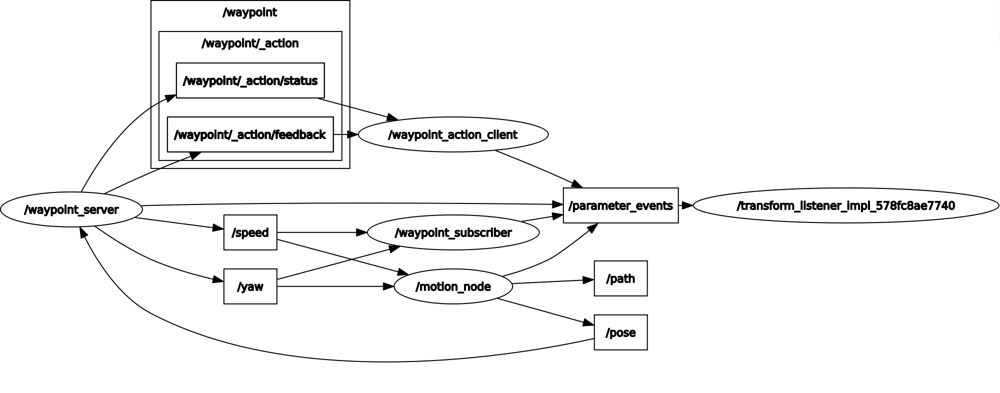
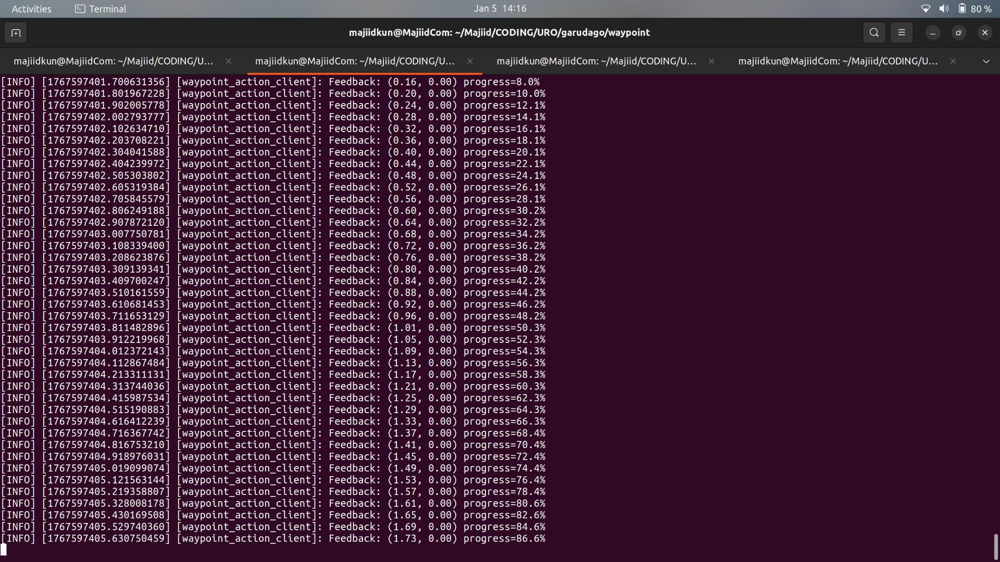
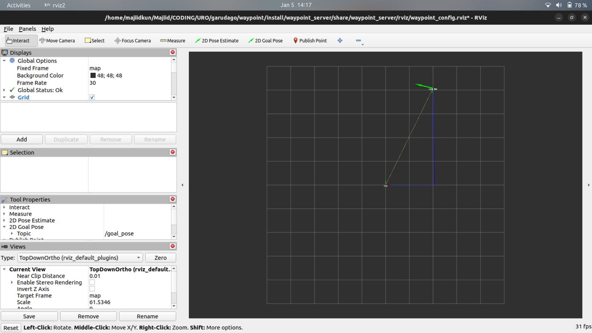

# Waypoint List

ROS 2 Action Server/Client system untuk navigasi waypoint dengan feedback real-time dan visualisasi Rviz.

## System Overview



### Nodes
- **waypoint_server** - Action server utama yang memproses permintaan waypoint
- **waypoint_subscriber** - Subscriber untuk monitoring speed dan yaw commands  
- **waypoint_action_client** - Client untuk mengirim waypoint goals
- **motion_node** - Node untuk update pose berdasarkan velocity commands

### Topics
- `/waypoint/_action/send_goal` - Action goal untuk waypoint baru
- `/waypoint/_action/feedback` - Feedback progress waypoint
- `/waypoint/_action/status` - Status eksekusi action
- `/speed` - Twist messages untuk kontrol kecepatan linear
- `/yaw` - Twist messages untuk kontrol rotasi angular
- `/pose` - PoseStamped untuk tracking posisi robot
- `/path` - Path messages untuk visualisasi jalur
- `/parameter_events` - ROS parameter updates

### Actions
- **WaypointSet** 
  - **Goal**: `absis`, `ordinat`, `yaw`, `duration`
  - **Result**: `success`, `speed`, `message`
  - **Feedback**: `absis_feedback`, `ordinat_feedback`, `yaw_feedback`, `progress`

## Visualisasi

### Action Feedback


### Rviz Display


---
## how to run
1. clone repo
```bash
git clone https://github.com/KRAI-ITB/waypoint-list.git
```
2. build package
```bash
colcon build
```
atau 
```bash
colcon build --package-select waypoint_action waypoint_server waypoint_client
```
3. jalankan server
```bash
source install/bash
ros2 run waypoint_server waypoint_server_node
```
jika ingin sekalian menjalankan node subscriber bisa menggunakan command
```bash
source install/bash
ros2 launch waypoint_server waypoint_server_launch.py
```

4. jalankan client

jalankan client pada terminal baru
```bash
source install/bash
ros2 run waypoint_client waypoint_client_node 
```
5. bisa juga send goal manual
```bash
ros2 action send_goal /waypoint waypoint_action/action/WaypointSet "{absis: 10.0, ordinat: 10.0, duration: 30.0}" --feedback
```
hapus --feedback jika tidak ingin mendapkan feedback

6. have fun :)

## Directory Structure:
```tree
src/
├── images/
│   ├── rosgraph.png -> ROS graph visualization
│   ├── Feedback.png -> Action feedback interface
│   └── Rviz.png -> Rviz visualization display
│
├── waypoint_action/
│   ├── action/
│   │   └── WaypointSet.action -> definisi parameter action
│   ├── include/
│   ├── CMakeLists.txt
│   ├── LICENSE
│   └── package.xml
│
├── waypoint_client/
│   ├── point/
│   │   └── meihua.yaml -> file waypoint list commands (test case)
│   ├── resource/
│   ├── test/
│   ├── waypoint_client/
│   │   └── waypoint_Action_Client.py -> client action node (waypoint_client_node)
│   ├── LICENSE
│   ├── package.xml
│   ├── setup.cfg
│   └── setup.py -> setup dan deklarasi node
│
├── waypoint_server/
│   ├── launch/
│   │   └── waypoint_server_launch.py -> launch file untuk semua nodes
│   ├── resource/
│   ├── test/
│   ├── waypoint_server/
│   │   ├── __init__.py
│   │   ├── waypoint_Action_Server.py -> server action node + publisher
│   │   ├── waypoint_subscriber.py -> subscriber node monitoring
│   │   └── motion_node.py -> pose update node
│   ├── rviz/
│   │   └── waypoint_config.rviz -> Rviz configuration
│   ├── LICENSE
│   ├── package.xml
│   ├── setup.cfg
│   └── setup.py -> setup dan deklarasi nodes
│
├── LICENSE
└── README.md
```


